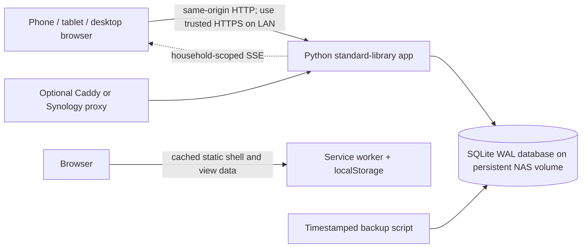

# Architecture



The app is a single process and a single database file. It is intentionally modest for a private alpha. The server is authoritative; browser cache is a convenience and can be cleared. Task completion is transactional and the points ledger has a uniqueness constraint to prevent duplicate awards.

The user-requested architecture uses Next.js, PostgreSQL and Drizzle. Network access to npm was unavailable during initialization, and a dependency-based app could not be installed or tested. Python's standard library and SQLite were selected for a usable no-package baseline, not as a claim of equivalence. A future migration should preserve the service API and household scoping while moving records to Postgres and adding the specified worker, validation library and typed client.

## Request flow

```mermaid
sequenceDiagram
  participant U as Household member
  participant W as Browser UI
  participant S as Local service
  participant D as SQLite
  U->>W: Complete assigned task
  W->>S: POST /api/items/{id}/complete + session + CSRF
  S->>D: Begin immediate transaction; scope item by household
  S->>D: Mark complete and insert unique ledger entry
  D-->>S: Commit once
  S-->>W: Updated item and version
  W-->>U: Show completed state
```
